  

  
  
  

## Hey, I'm Hari

I'm an infrastructure engineer, and networking is the part of the job I enjoy the most. Give me a routing table that doesn't make sense and I'm happy for the rest of the afternoon.

What I'm up to right now:

- Studying for CCNP SPCOR (the service provider track, so a lot of BGP and MPLS)
- Building and breaking labs in Packet Tracer and GNS3
- Working with Azure and Terraform on the cloud side
- Making networking videos on [Cisroute](https://www.youtube.com/@Cisroute-Hari) and writing at [cisroute.com](https://www.cisroute.com)

If you're studying for your CCNA or CCNP too, or you've got a strange routing problem, I'm always happy to talk about it.

 

## From the lab

  

## Latest videos

<!-- YOUTUBE:START -->
- New videos show up here automatically. In the meantime, the channel is at [youtube.com/@Cisroute-Hari](https://www.youtube.com/@Cisroute-Hari).
<!-- YOUTUBE:END -->

## What I work with

  
  
  
  
  
  
  
  

OSPF, EIGRP and BGP for routing. VLANs, STP and EtherChannel for switching. Lots of subnetting, and Wireshark open in another window when something breaks. Lately I've been learning MPLS and trying to automate more of my lab work with Python.

## Say hi

  

  The easiest way to reach me is <a href="https://www.linkedin.com/in/hariharan-ravi1/">LinkedIn</a>. You can also find me on <a href="https://www.youtube.com/@Cisroute-Hari">YouTube</a> or at <a href="https://www.cisroute.com">cisroute.com</a>.

